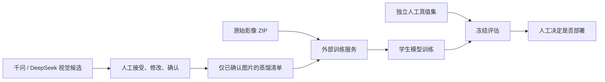

# 教师模型蒸馏接口 · v1.0 草案

## 目标与当前交付

千问和 DeepSeek 视觉模型可作为**教师**提出 2D 候选框；标注员在道路设施复核页接受、修正并确认图片后，才把标签交给自有的 2D 检测**学生**模型训练。当前视觉接口不返回可校准的类别概率或 logits，因此 v1 是**经人工确认的硬标签训练**，不是基于教师概率分布的软标签蒸馏。不能把全景 2D 区域直接当作有度量意义的点云 3D 框。

本仓库已实现“导出蒸馏清单”，以及 `src/distillation.ts`、`src/distillationContract.ts`、`src/distillationClient.ts` 中的类型与客户端适配层。**训练服务、影像集上传页面、任务监控页面、权重和自动部署尚未实现。**模型同事可按下述契约独立实现服务；不要将当前原型描述为已完成训练闭环。



## 标注端导出

道路设施复核页的“导出蒸馏清单”按钮仅在至少一张图片已确认时可用。下载的 `*-distillation-v1.json` **只含已确认图片**，保留空标注图作为负样本，以及每个框的人工、原有 YOLO 或模型候选来源。它不包含图片二进制、API Key、未确认图片或模型原始对话。普通“导出 YOLO ZIP”仍是复核进度交付物，内含未确认任务，**不可直接当成训练集**。

清单中的 `imageKey` 是原文件名；训练服务须从另外上传的影像 ZIP 中按名称匹配。文件名不是服务端路径。`box` 顺序为归一化的 `[centerX, centerY, width, height]`；`classIndex` 与当前 `class.txt` 顺序一致，`classId` 是稳定名称。`review: "confirmed"` 是**整张图已经人工检查**，不表示某个框经过几次修改；现有编辑器不记录逐框修改历史。

示例片段（实际导出包含全部七个类别）：

```json
{
  "schemaVersion": "1.0",
  "task": "image-detection",
  "datasetId": "data_for_annotation",
  "exportedAt": "2026-10-11T00:00:00.000Z",
  "selection": "reviewed-only",
  "coordinates": "xywh-center-normalized",
  "classes": [{ "index": 0, "id": "sign" }],
  "samples": [{
    "imageKey": "cam_001.jpg",
    "review": "confirmed",
    "labels": [{
      "id": "candidate:123",
      "classId": "sign",
      "classIndex": 0,
      "box": [0.5, 0.4, 0.2, 0.1],
      "source": {
        "kind": "model-prediction",
        "provider": "qwen",
        "profileId": "teacher-qwen",
        "modelName": "qwen3-vl-plus"
      }
    }]
  }]
}
```

`source.provider` 可为 `qwen`、`deepseek`、`http` 或 `unknown`。旧 YOLO 框没有模型 ID，记为 `imported-prediction`；人工新建框记为 `manual`。若用户删除了模型配置，旧框仍保留 `profileId`，但提供方可能变成 `unknown`。视觉 LLM 没有可信的检测置信度，导出器不会编造分数。训练服务应把教师来源写入训练报告，以便比较千问、DeepSeek、人工标签的贡献。

## 外部训练服务 API

服务根地址由部署方提供；浏览器客户端只允许 HTTPS 或本机 HTTP。认证、权限、存储清理、限流和数据驻留由服务端负责，浏览器不得持有云模型密钥。所有响应均为 JSON，`schemaVersion` 固定为 `"1.0"`；非 2xx 返回 `{ "error": { "code": "...", "message": "..." } }`。

| 方法与路径 | 用途 | 主要输入／输出 |
| --- | --- | --- |
| `POST /v1/distillation/image-sets` | 上传原图 ZIP | `multipart/form-data` 的 `file`；返回 `imageSetId` 和 `validating` 状态 |
| `GET /v1/distillation/image-sets/{id}` | 查询影像集 | `ready` / `rejected`、图数或错误 |
| `POST /v1/distillation/datasets` | 注册不可变标注快照 | `imageSetId` + 上述 `manifest`；返回 `datasetId` |
| `GET /v1/distillation/datasets/{id}` | 查询匹配与校验 | `ready` / `rejected`、样本数、缺失图片名、清单 SHA-256 |
| `POST /v1/distillation/jobs` | 创建学生训练 | 训练集、独立评估集、学生 recipe 和标签来源策略；返回 `jobId` |
| `GET /v1/distillation/jobs/{id}` | 查询训练状态 | `queued` / `running` / `succeeded` / `failed` / `cancelled`、指标与产物 ID |
| `POST /v1/distillation/jobs/{id}/cancel` | 取消作业 | 返回更新后的任务状态 |

前端/集成方可使用 `createDistillationClient(endpoint)` 调用 `uploadImageSet`、`getImageSet`、`registerDataset`、`getDataset`、`createJob`、`getJob` 和 `cancelJob`；类型定义在 `src/distillationContract.ts`。例如，`uploadImageSet(imagesZip, crypto.randomUUID())` 上传影像档案，待状态变成 `ready` 后再以其 `imageSetId` 注册清单。创建训练作业时也传独立幂等键；前端可按需轮询 `getJob`，不要依赖固定训练时长。当前页面**没有调用**这些方法，因为仓库还未提供可用的训练服务。

上传 ZIP 使用 `images/<imageKey>` 路径；服务端必须流式接收（当前原图约 511 MB）、限制解压体积、拒绝路径穿越和重复文件名，并计算内容哈希。`POST image-sets` 与 `POST jobs` 需传 `Idempotency-Key`，以免网络重试造成重复上传或重复训练。若影像匹配失败，不得静默丢弃样本。`POST datasets` 的 JSON 不应包含本机绝对路径；服务器对已注册的影像集与清单逐一匹配，并固定快照。

### 注册数据集

`POST /v1/distillation/datasets` 请求：

```json
{
  "schemaVersion": "1.0",
  "imageSetId": "imageset-20261011-01",
  "manifest": { "schemaVersion": "1.0", "task": "image-detection", "datasetId": "data_for_annotation", "exportedAt": "2026-10-11T00:00:00.000Z", "selection": "reviewed-only", "coordinates": "xywh-center-normalized", "classes": [{ "index": 0, "id": "sign" }], "samples": [{ "imageKey": "cam_001.jpg", "review": "confirmed", "labels": [] }] }
}
```

返回 `202`：`{ "schemaVersion": "1.0", "datasetId": "dataset-snapshot-01", "state": "validating" }`。数据集转为 `ready` 后才能训练。服务端验证坐标边界、类别顺序、唯一图片名、影像存在性和已确认状态；空 `labels` 是经确认的负样本。训练集与评估集应分别注册，评估集只使用独立的人工真值。

### 创建训练任务

`POST /v1/distillation/jobs` 请求：

```json
{
  "schemaVersion": "1.0",
  "trainDatasetId": "dataset-snapshot-01",
  "evaluationDatasetId": "human-holdout-01",
  "student": {
    "modelId": "road-furniture-detector",
    "recipeId": "yolo-detection-v1",
    "baseVersion": "baseline-20261001"
  },
  "labelSelection": {
    "includeManual": true,
    "includeImportedPredictions": false,
    "teacherProviders": ["qwen", "deepseek"]
  },
  "seed": 42
}
```

返回 `202`：`{ "schemaVersion": "1.0", "jobId": "distill-job-01", "state": "queued" }`。`recipeId` 由训练服务管理，定义架构、超参数、算力和训练代码版本；前端不直接执行命令或上传可执行代码。选择标签来源时，若一张图的框被过滤掉，**不能把该图当作空标注负样本**；只有原清单中 `labels: []` 才是真负样本。服务端应跳过来源过滤后不完整的图片，或按明确的完整性规则拒绝任务。

`GET jobs/{id}` 成功后返回 `metrics`，包含同一冻结评估集上的基线与学生指标（如 `mAP50`、`mAP50-95` 和各类 AP）、样本数、教师来源统计，并给出 `modelArtifactId`。指标由服务端计算，不能用训练集或未经确认的教师预测充当评估真值。按图片哈希、采集地点／序列分组检查训练与评估集重叠；发现泄漏时返回 `422 DATA_LEAKAGE`。**没有自动部署端点**，模型提升由人员审核后另行发布。

## 后续多模态扩展

v1 只输出道路设施图片的 2D 检测训练清单。全景区域可在下一版增加独立的 `panorama-region` 样本契约，保留 2:1 等距柱状投影、归一化 UV 和配准版本。点云 3D 框、逐点语义和跨视图关系必须来自已核验的点云／全景联合标注，不能由当前视觉 LLM 的 2D 结果自动推断。软标签蒸馏需未来教师服务明确提供可用的类别分布及温度定义后另订协议。

调用云端教师模型并把结果用于训练前，团队应核对具体服务和模型版本的数据使用条件。原图、审核清单和学生权重默认保留在自有训练环境，不进入本仓库或 Windows/macOS 软件包。
