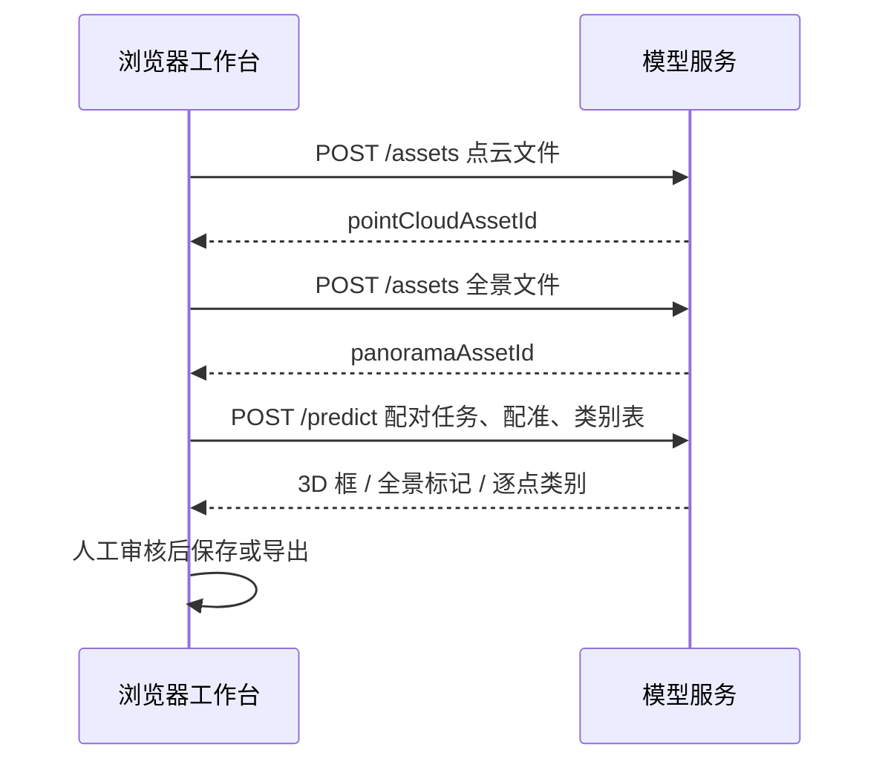

# 预标注服务接口（草案 v0.2）

## 当前道路设施图片批次

当前复核页读取 `data_for_annotation/labels/*.txt` 中已经生成的 YOLO 预标注。YOLO 每行是 `classId centerX centerY width height`，后四项归一化到 `[0,1]`，类别编号严格按 `class.txt`：`sign, sign_s, fence, sign_p, fence_v, sign_d, pole`。此外，用户可配置 `atlas-image-v1` 服务对当前图片另行预测，输出先进入待审核层。道路设施批次没有点云和相机外参，不使用下述点云/全景联合预测接口。详见 [批次规则](ROAD_FURNITURE_REVIEW.md)和[模型切换说明](MODEL_SWITCHING.md)。

### 图片适配器 `atlas-image-v1`

先向服务根地址的 `POST /assets` 发送 `multipart/form-data`：`kind=image`，`file` 为当前 JPG/PNG；返回 `{ "assetId": "..." }`。随后调用 `POST /predict`：

```json
{
  "schemaVersion": "1.0",
  "taskId": "cam_001.jpg",
  "imageAssetId": "asset-image-001",
  "classes": ["sign", "sign_s", "fence", "sign_p", "fence_v", "sign_d", "pole"]
}
```

响应示例：

```json
{
  "schemaVersion": "1.0",
  "modelVersion": "road-detector-2",
  "boxes": [
    { "classId": 0, "x": 0.5, "y": 0.4, "w": 0.2, "h": 0.1, "confidence": 0.91 }
  ],
  "warnings": []
}
```

`classId` 必须是上述数组的 0–6 索引；`x/y/w/h` 是中心与宽高，范围归一化到 `[0,1]`，整个框须在图片内。前端拒绝无效框。`boxes` 可为空。不要在服务端直接覆盖原 YOLO TXT；由标注员逐个接受候选。

## 当前状态

点云／全景工作台已调用 `src/prelabel.ts` 的上传和预测适配器，并用 `src/modelApi.ts` 检查返回结果。**仓库不包含真实模型、推理服务、用户认证或资产服务器。**用户需配置自己的服务，点击运行后才发送当前任务文件。此文档供后端和模型同事并行实现，接线前先共同确认版本。

## 数据流



本地导入产生的 `blob:` URL 只能在当前浏览器中使用，服务端无法读取。接入模型时先上传文件，之后只传资产 ID。服务器应限制文件大小、校验格式，并把资产 ID 限定在有权限的任务范围内。

## `POST /assets`

`multipart/form-data`，字段：

| 字段 | 类型 | 说明 |
| --- | --- | --- |
| `kind` | `pointCloud` / `panorama` | 与文件用途对应 |
| `file` | 二进制文件 | 点云 PCD/PLY，影像 JPG/PNG |

成功返回 `201` 或 `200`：

```json
{ "assetId": "asset-cloud-001" }
```

上传函数是 `uploadPrelabelAsset(endpoint, file, kind)`。当前前端直接导入点云上限 150 MB；服务端应有自己的文件大小限制和存储清理策略。

## `POST /predict`

`Content-Type: application/json`。完整请求示例：

```json
{
  "schemaVersion": "0.2",
  "taskId": "JSZ-001298",
  "pointCloudAssetId": "asset-cloud-001",
  "panoramaAssetId": "asset-pano-001",
  "pointCount": 100000,
  "coordinateSystem": "camera-local: +X right, +Y up, -Z forward",
  "registration": {
    "position": [0, 0, 0],
    "rotation": [0, 0, 0]
  },
  "classes": [
    { "id": "sign", "name": "标志牌", "color": "#e46c91", "shortcut": "4" }
  ]
}
```

`registration.position` 为全景相机在点云坐标系中的位置；`rotation` 为角度制 `[yaw, pitch, roll]`。零旋转看向 −Z。服务端必须使用与输入点云一致的坐标系输出 3D 框；全景坐标使用归一化 `[u,v]`，左上角为 `[0,0]`、右下角为 `[1,1]`，影像为 2:1 等距柱状全景。类别使用请求中的 `id`，不要靠名称匹配。

成功响应示例：

```json
{
  "schemaVersion": "0.2",
  "modelVersion": "example-model-1",
  "annotations": [
    {
      "id": "PRED-001",
      "classId": "sign",
      "name": "候选标志牌",
      "visible": true,
      "origin": "prediction",
      "confidence": 0.92,
      "pointCloud": {
        "kind": "cuboid",
        "center": [2.4, 3.1, -8.7],
        "size": [1.2, 0.8, 0.15],
        "yaw": 15
      },
      "panorama": {
        "kind": "point",
        "uv": [0.43, 0.37]
      }
    }
  ],
  "semanticPointLabels": [
    { "pointIndex": 42, "classId": "sign", "confidence": 0.85 }
  ],
  "warnings": []
}
```

同一实例在 `pointCloud` 和 `panorama` 字段共用一个对象 ID。`semanticPointLabels` 可省略；若返回，`pointIndex` 必须对应上传 PCD/PLY 解析后**原始点的顺序**，不能按模型降采样结果编号。`confidence` 为可选的 0–1 分数。模型结果先进入待审核层；仅人工接受的候选会加入正式标注，已有逐点类别不会被预测覆盖。

## 错误、跨域与版本

- 非 2xx 为失败；建议 JSON 错误体 `{ "error": { "code": "INVALID_ASSET", "message": "..." } }`。前端适配器当前显示 HTTP 状态码。
- 浏览器直接请求服务时，服务须配置明确的 CORS 允许来源；生产环境使用 HTTPS。不要把密钥写进前端代码或仓库。
- 适配器对上传设 5 分钟超时、同步预测设 2 分钟超时。更长任务可在下一版改成异步作业接口。
- `schemaVersion` 与导出 JSON 的版本均为 `0.2`，未来变更字段语义时应升级版本并提供迁移说明。
- `src/prelabel.ts` 做基本响应结构检查，`src/modelApi.ts` 再验证坐标、类别和点索引；服务端仍需按完整字段校验请求，并返回可追踪的错误。

## 下一阶段接线检查清单

1. 实现真实模型服务、资产上传及服务端格式校验，确认点顺序和影像投影约定。
2. 将服务地址添加到配置页，运行单任务并人工审核候选；在真实模型上校验类别与坐标。
3. 大规模部署前增加异步作业、资产清理、认证、审计和多人冲突控制。
4. 用点云、全景、注册位姿和逐点标签的固定样本进行端到端检查，重点验证 3D→全景投影与类别 ID。
