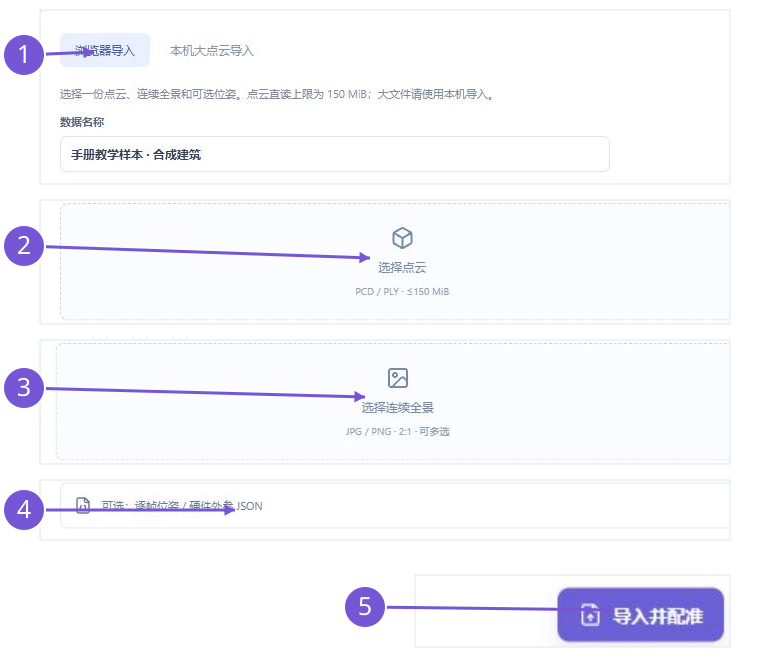
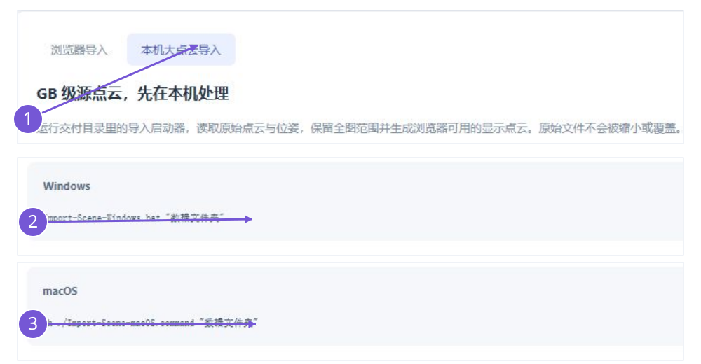
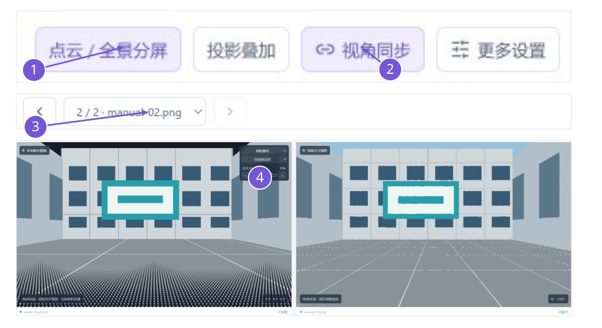
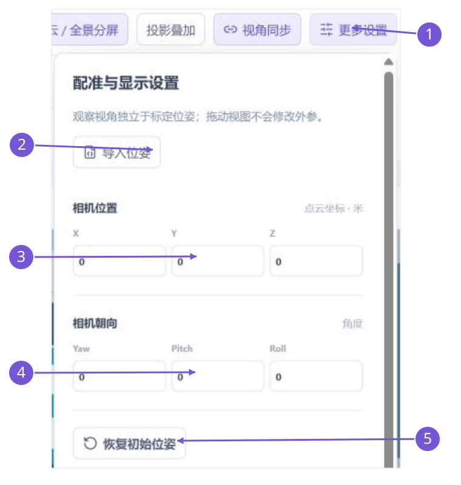
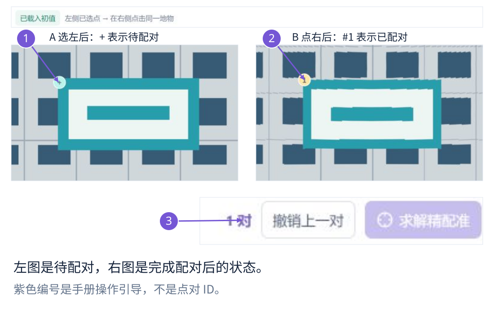
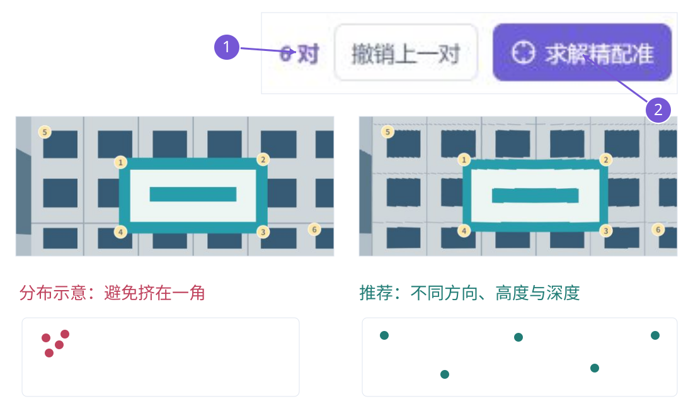
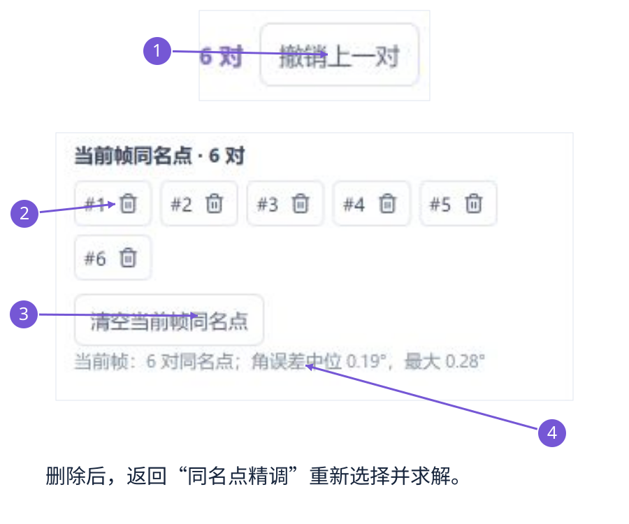
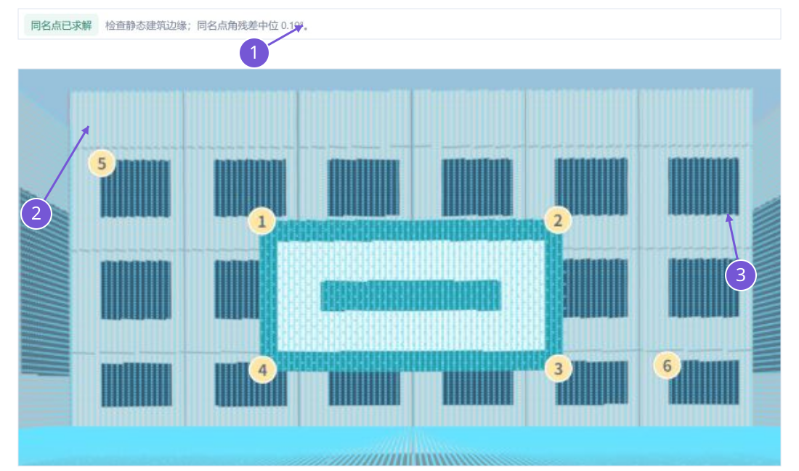
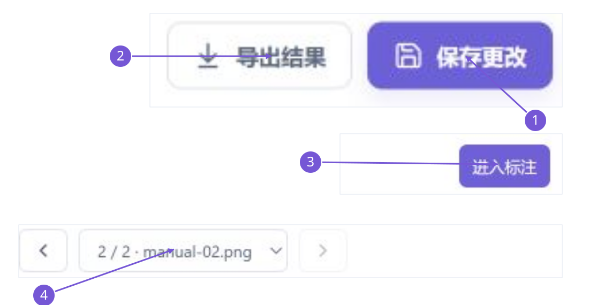
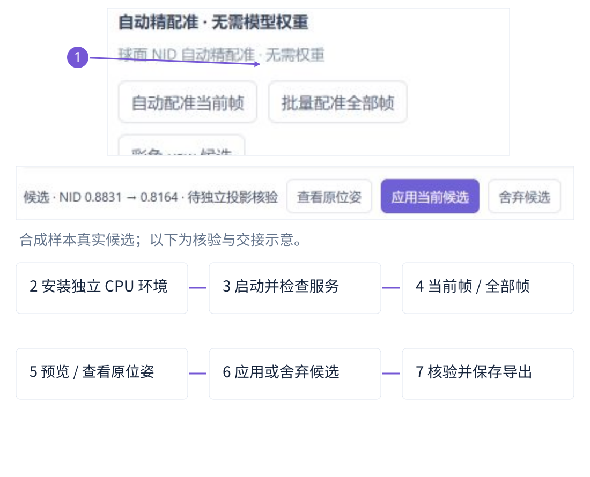

# 点云与全景影像配准模块操作手册

适用软件：SCRI Labeling 0.16.0。手册修订：2026-11-10，第 4 版 · 操作图解与 DA² 接入版。

0.16.0 新增 DA² 深度辅助配准，本手册第 16 章说明关键步骤。详细模型接口、坐标约定与部署说明见独立文件 docs/DEPTH_REGISTRATION.md。前 10 张图解保留 0.15.0 合成教学场景，不将旧截图冒充新模型的真实数据效果。

本手册依据当前仓库实现编写，供标注员、数据准备人员和接入算法的同事使用。Windows 与 macOS 使用相同页面和数据协议，启动、路径和模型部署差异在相应平台 PDF 与第 2、10 章说明。文中的示例参数用于解释结构，不能直接作为真实设备标定值。

## 1. 先理解配准模块解决什么问题

配准要确定每张全景相机在点云坐标系中的位置和朝向，使同一个静态地物在点云与全景中对应。当前保存的是逐帧相机位姿，包含位置 X/Y/Z 和角度 Yaw/Pitch/Roll。配准对象是一份场景点云与连续全景，不是把两份点云互相拼接。

主流程为“数据 → 配准 → 标注 → 训练”。配准页面只有“粗配准 → 同名点精调 → 投影核验”三个步骤。圈选目标、修改多边形和生成目标 3D 框在标注页面完成，不在配准页面重复操作。

| 容易混淆的操作 | 实际作用 | 是否改变配准参数 |
| --- | --- | --- |
| 拖动、缩放观察视图 | 改变用户看向哪里、视场多大 | 否 |
| 开关视角同步 | 联动或解除联动两侧观察相机 | 否 |
| 点云投影叠加 | 显示当前位姿下的投影结果 | 否 |
| 改 X/Y/Z 或 Yaw/Pitch/Roll | 修改当前帧相机在点云中的位姿 | 是 |
| 求解精配准 | 用当前帧同名点估计六自由度位姿 | 成功且通过门限后改变 |
| 预览 自动精配准 候选 | 暂时用候选显示，便于比较 | 未应用前不写入正式逐帧位姿 |

没有硬件外参或源位姿时，仍可人工提供初值和选点求解，但不能期待页面自动知道未知设备的轴向、杆臂、全景零方位或采集时间偏移。自动精配准可在已有粗位姿附近生成候选，信号不可靠时保留原位姿。

## 2. 启动与平台差异

常规平台包需要 Node.js 20+，无需再次安装 npm 依赖。完整解压后：Windows 双击 `Start-Atlas-Windows.bat`；macOS 在终端进入解压目录，运行 `sh ./Start-Atlas-macOS.command`。保持终端运行，使用终端实际打印的地址。

服务只监听本机 127.0.0.1。默认尝试 43127，端口占用时会尝试后续端口并最终使用可用端口。不要把旧消息里的端口当作永远有效的地址，不要结束其他项目来释放端口。关闭启动进程后，原地址不可继续访问。

| 使用方式 | 操作 |
| --- | --- |
| 从常规 ZIP 启动 | 使用对应平台的 Start-Atlas 启动器 |
| 从源码启动 | 首次 `npm ci`，然后 `npm run build`，再 `npm run serve` |
| 使用已准备的场景 | `node scripts/serve.mjs --scene-dir PREPARED_SCENE` |
| 使用本机四场景试用包 | Windows 用 Start-Suite-Windows.bat；macOS 用 `sh ./Start-Suite-macOS.command` |

检查左下角版本。已有页面不会因磁盘构建更新而自动换成新界面；先保存并导出，再刷新。常规 GitHub 平台包包含合成样本，真实点云和影像需要另外提供；本机含真实数据试用包不能视为仓库的公开资产。

macOS 的前端与接口共享同一实现。当前真实图形交互主要在 Windows/本机浏览器验证，实体 Mac 的 GPU 表现仍需验收。无权重 CPU 后端安装见第 10 章。

## 3. 数据准备与两种导入方式

先准备同一场景的点云、原始全景、逐帧位姿。位置和点坐标必须使用同一原点、轴约定、尺度；建议统一米制。确认影像确为等距柱状 360° 全景，通常宽高比 2:1。普通透视照片不应作为这种全景直接导入。

### 3.1 浏览器导入：适合小场景

1. 左侧选择“数据”，选择“点云 + 全景”，点击“导入数据”。
2. 保持“浏览器导入”，选择一份 PCD 或 PLY。
3. 多选对应的 JPG/JPEG/PNG 全景，检查文件名没有重复。
4. 选择可选的“逐帧位姿 / 硬件外参 JSON”，格式见第 6 章。
5. 输入易识别的数据名称，点击“导入并配准”。

点云直读阈值为 150 MiB，是文件体积，不是空间范围 150 m。场景可以超过 150 m；大源文件应走本机预处理。浏览器中选择的原文件不会被覆盖。

如果每张图都提供 utcSeconds，导入时按时间排序；否则按自然文件名排序。时间字段不是时间同步算法，不会自动补偿扫描运动。部分帧缺位姿时会提示，缺失帧不能直接参与多帧定位或保持同步观察。

浏览器导入的文件通过当前会话的 blob 引用访问。刷新后不保证恢复该导入任务和资产；保存到浏览器不等于已经上传或建立服务器资产库。长期使用建议改为本机场景目录。

### 3.2 本机大点云导入：先处理、后浏览

在数据页切换“本机大点云导入”，按对应平台运行：

```text
Windows: Import-Scene-Windows.bat "DATASET_FOLDER"
macOS:   sh ./Import-Scene-macOS.command "DATASET_FOLDER"
```

需要 Python 3.10+、Node.js 20+；首次运行会在项目目录建立独立的 .venv-scene-import 并安装导入依赖。源目录合同如下，imgs 名称可以不同，但位姿 CSV 与全景必须在同一目录：

```text
DATASET_FOLDER/
  DenseMap.pcd
  imgs/
    CameraPoseInSlam.csv
    1.jpg
    2.jpg
    genericImagePositions.csv   # 可选时间表
```

当前脚本要求整个数据目录中恰有一个 CameraPoseInSlam.csv，包含 Image id 和 T00 至 T23；DenseMap.pcd 为可读取的 binary PCD，支持脚本规定的 XYZ/强度或 packed RGB 字段。自动导入不是任意格式的通用转换器。

脚本保留全图范围并生成显示点云，默认预算约 180 万代表点；显示点索引与原始点索引不同。不存在的源几何不会被补造。当前本机场景服务最多 1000 帧、显示点云文件不超过 150 MiB；可拆分序列或减少试用帧。尚未提供海量原始点按需分块流式加载。

显式高级导入示例：

```text
python scripts/import_scene_dataset.py DATASET_FOLDER \
  --output PREPARED_SCENE --max-frames 7 \
  --point-budget 4500000 --world-axes z-up \
  --camera-axes flu --matrix-direction camera-to-world
node scripts/serve.mjs --scene-dir PREPARED_SCENE
```

以上反斜线是排版续行示意；Windows PowerShell 请将整条 Python 命令放在一行，或使用 PowerShell 的续行语法。输出目录必须不存在，以保护已使用的资产和点索引。相机/世界轴向必须根据源数据确认，不能为了“看起来对齐”随意试固定 180° 修正。

## 4. 第一次使用：一套可照着走的流程

1. 启动平台，确认版本和地址。进入数据页，选择已有场景或完成双源导入。
2. 进入“配准”。在“粗配准”检查当前帧文件名、位姿来源、点云覆盖与大致朝向。
3. 若没有初值，先“导入位姿”；若已有源位姿，先用分屏和投影检查，不必重复导入。
4. 点击“下一步：同名点”。左点云选一个静态角点，再在右全景点同一物理位置，完成一对。
5. 选 6-10 对分散的点；至少 4 对才可点击“求解精配准”。
6. 成功后进入“投影核验”，检查未参与求解的静态地物。失败则返回修正对应点。
7. 保存更改并导出结果。切换邻帧，重复检查，不要假设第一帧的结果会自动标定整段轨迹。
8. 核验后点击“进入标注”。需要从图像圈目标生成点云框时再使用标注页功能。

最短可用路线不依赖 自动精配准：源位姿/人工初值 → 同名点精调 → 独立投影核验。推荐先让这一条路线在自己的数据上稳定，再增加自动候选服务。

下面 10 张图解可按顺序操作。截图来自当前 0.15.0 界面，使用本地生成的合成建筑教学场景，不是真实采集影像，也不用于证明实际配准精度。截图按操作区域裁切与排列；紫色圆圈/箭头是手册引导编号，界面原有黄色编号是同名点对 ID。Windows 和 macOS 共用这些界面步骤，启动命令不同。

### 图解 1：浏览器导入，依次选择三类文件



1. 在“数据 → 点云 + 全景 → 导入数据”打开面板。编号 1 保持“浏览器导入”，填写数据名称。
2. 编号 2 选择一份 PCD/PLY。编号 3 一次多选同一序列的 2:1 全景；不要分别建成互不关联的单图任务。
3. 编号 4 选择逐帧位姿/硬件外参 JSON；没有初值可暂不选，但之后须补充或人工调整。
4. 检查点云不超过 150 MiB、图像名不重复，再点编号 5“导入并配准”。应进入配准页面，帧数与导入数量一致。格式详见第 6 章。

### 图解 2：大源点云走本机预处理



1. 在同一导入面板切到编号 1“本机大点云导入”。这里显示运行说明，不是在浏览器里直接上传 GB 文件。
2. Windows 按编号 2 运行 Import-Scene-Windows.bat；macOS 按编号 3 用 sh 运行对应 .command。两条命令任选本平台的一条。
3. 将“数据文件夹”替换为实际源目录，包含 DenseMap.pcd、唯一 CameraPoseInSlam.csv 和对应全景。目录结构、支持字段及高级参数见第 3.2 节。
4. 等待预处理完成，用启动器打印的地址打开场景；核对全景数量、地图覆盖和来源说明。不要将 150 MiB 文件限制解释成 150 m 空间范围。

### 图解 3：分屏、视角同步、切帧与点大小



1. 编号 1 选“点云 / 全景分屏”观察两侧；需要比较投影时切“投影叠加”。切布局不修改外参。
2. 编号 2 显示“视角同步”时，两侧联动旋转与缩放；点一下变为“自由观察”。解除同步以当前视角作为起点，观察操作不写入标定位姿。
3. 编号 3 用箭头或“当前全景帧”切换。检查图像文件名、相机位置和点云观察方向随该帧更新；切第二帧不会自动继承第一帧的精配准结果。
4. 编号 4 调整点大小，让角点清楚可见。点径过大会遮挡边缘，过小会看起来稀疏；这不会改变原始点数。

### 图解 4：导入初值与人工改位姿



1. 编号 1 打开“更多设置”；编号 2“导入位姿”用于导入第 6 章规定的 JSON，CSV 需先转换。
2. 编号 3 是相机位置 X/Y/Z，单位米。编号 4 是 Yaw/Pitch/Roll，单位度；每次小幅调整，观察同一地物是否向正确方向靠近。
3. 一般先核对轴向和整体朝向，再校正局部错位；不要用转动全景观察视图冒充修改外参。
4. 编号 5“恢复初始位姿”回到该帧源初值，不是回到“上一次保存”。已经精调过时先导出备份，再决定是否恢复。

### 图解 5：一对同名点，先左后右



1. 进入“同名点精调”，保持正确的当前帧。编号 1 在左侧点云选静态、清楚的物理角点，例如标牌的同一外角。
2. 看到“左侧已选点 → 在右侧点击同一地物”后，按编号 2 在右侧全景点击这个角点；不要选到同一物体上的另一个角。
3. 编号 3 计数增加为“1 对”，两侧出现黄色 #1，说明点对已完成。点云选中但右侧未点时，不会增加完整点对计数。
4. 选错了按图解 7 的撤销/删除方法重选；当前同名点没有拖动顶点功能。具体选点与求解规则见第 8 章。

### 图解 6：分散选点后求解，成功即应用



1. 重复“左点云 → 右全景”，建议选 6-10 对。编号 1 核对计数；至少 4 对才能启用编号 2“求解精配准”。
2. 选点分散在左右、上下，尽量兼有远近深度；避免都挤在一个窗角或只沿同一条边选择。当前帧的点对不能与另一帧混在一起求解。
3. 点编号 2 后，成功且通过残差门限会直接更新当前帧位姿，并自动切到“投影核验 / 投影叠加”；没有额外的“接受同名点候选”按钮。
4. 若提示点位过于集中、影像跨度不足或残差偏大，返回修正点对再求解。成功求解后仍须检查未参与求解的地物。

### 图解 7：撤销、删除指定点对、清空与重选



1. 刚刚选错最后一对时，编号 1“撤销上一对”删除当前帧最后一个完整点对。
2. 较早的一对选错时，在“更多设置 → 当前帧同名点”找到黄色编号对应的 #N，点编号 2 所指的垃圾桶。删除整对后，回到“同名点精调”按左、右顺序重选。
3. 编号 3“清空当前帧同名点”用于整帧重做；不要当成撤销最后一步。它不会自动恢复先前的点对。
4. 编号 4 是上次解算质量信息。删点本身不会重算位姿；修正后必须重新“求解精配准”，再投影核验、保存。不要把旧残差当作修改后已重算的结果。

### 图解 8：投影核验，应看没有参与求解的边缘



1. 编号 1 仅表示已用当前点对完成拟合及其角残差，不能据此宣称整套场景达到 4°。
2. 沿编号 2/3 所指的其他立面边缘、窗框或墙地交线查看：青色投影点是否沿同一物理边缘分布，是否存在整体双边或明显错层。
3. 拖动环视检查不同方向、近远目标；必要时回“更多设置”开关投影以对照。遮挡、点稀疏和扫描运动不一定是外参错误，排错见第 12 章。
4. 有系统性偏移就回“同名点精调”修正；通过后再检查相邻帧。独立量化验收方法见第 9 章。

### 图解 9：保存、导出、逐帧复核，再进入标注



1. 编号 1“保存更改”写入当前浏览器来源的本地存储，完成后变为“已保存”；它不是上传团队服务器。
2. 编号 2“导出结果”下载 JSON。另行保管原始点云、全景、位姿和文件对应关系，JSON 不内嵌原始媒体。
3. 编号 4 逐帧复核，缺位姿或待核验的帧先处理好；当前帧的状态不能代表所有帧。
4. 核验后点击编号 3“进入标注”。厚度物体的完整轮廓、多帧圈选和 3D 候选审核在标注页完成。
5. 需要重新导入导出文件中的位姿时，用第 11 章的提取工具；完整标注导出不是“导入位姿”直接接受的格式。

### 图解 10：自动配准的前提、候选与人工验收



1. 编号 1 显示已就绪的本机 NID 服务；点击当前帧或批量入口。下方流程示意说明生成候选后的操作，不代表测区精度已验收。
2. 按第 10 章安装独立 CPU 环境，启动平台并确认服务就绪；无需模型权重。
3. 请求当前帧/全部帧后，等待候选返回。先“预览候选 / 查看原位姿”比较，再“应用当前候选 / 应用全部候选”，不合适则“舍弃候选”。这些候选控件只有返回结果后才出现。
4. 应用后仍按图解 8/9 独立核验、逐帧检查并保存导出。颜色 yaw 路径另见第 10 章，它成功时直接应用。

## 5. 配准界面逐项说明

上方三个步骤控制工作阶段；“点云 / 全景分屏”和“投影叠加”控制布局；“视角同步 / 自由观察”控制观察联动。“更多设置”放参数、算法候选、同名点管理及当前质量信息。

| 页面元素 | 用法与注意事项 |
| --- | --- |
| 粗配准 | 检查或导入当前数据的位姿初值，不表示已完成精标定 |
| 同名点精调 | 左侧选三维点，再在右侧当前全景选对应像素 |
| 投影核验 | 查看静态地物与点云投影是否贴合；可返回前一步 |
| 当前全景帧 | 下拉选择；左右箭头是上一帧/下一帧 |
| 位姿来源标签 | 区分导入、INS 近似、人工、同名点、颜色或 自动精配准 来源，不是精度证书 |
| 更多设置 | 查看/改位置与角度、导入位姿、自动服务、删除点对与质量信息 |
| 保存更改 | 保存当前任务的位姿、同名点等到此浏览器来源 |
| 导出结果 | 下载包含逐帧位姿、来源、点对和标注的 JSON |
| 进入标注 | 切到标注工作台；不会自动证明配准已达到规定精度 |

点云面板内可调“点大小”、点径模式与着色，并放大点云窗口。增大点径有利于看结构，但过大会盖住角点。高程或强度着色只改显示，不能把强度点云变成有真实 RGB 的点云。

## 6. 位姿 JSON：四种可用输入

“导入位姿”只接受指定格式的 JSON。CSV 不能直接拖入这个输入框。设备 CSV、INS 表和外参需先转换；任意旋转角表不能直接当作已核准的逐帧相机位姿。

### 6.1 推荐：每张图一个 cameraToCloud

```json
{
  "schemaVersion": "registration/1.0",
  "frames": [
    {
      "image": "1.jpg",
      "utcSeconds": 1.0,
      "cameraToCloud": [
        1,0,0,0, 0,1,0,1.6, 0,0,1,0, 0,0,0,1
      ]
    },
    {
      "image": "2.jpg",
      "utcSeconds": 2.0,
      "cameraToCloud": [
        1,0,0,1, 0,1,0,1.6, 0,0,1,0, 0,0,0,1
      ]
    }
  ]
}
```

这是结构示例：两相机沿 X 相差 1 m，不是真实设备参数。仓库附有同内容的 examples/registration/poses-two-frames.json。image 要与导入的文件名匹配，匹配忽略大小写；重复记录、未知影像名、空 frames 或无效数值会报错。

### 6.2 硬件外参与逐帧平台位姿

```json
{
  "hardware": {
    "cameraToBody": [
      1,0,0,0.2, 0,1,0,0, 0,0,1,0, 0,0,0,1
    ]
  },
  "frames": [
    {
      "image": "1.jpg",
      "bodyToCloud": [
        1,0,0,10, 0,1,0,1.6, 0,0,1,0, 0,0,0,1
      ]
    }
  ]
}
```

系统按 cameraToCloud = bodyToCloud × cameraToBody 组合。这里的 cameraToBody 必须已包含正确的相机轴变换、安装角和杆臂。设备给的是 LiDAR-to-camera、camera-to-LiDAR 或世界到相机时，应先明确方向再转换。

### 6.3 旋转矩阵加位置

```json
{
  "rotationMatrixRowMajor": [1,0,0, 0,1,0, 0,0,1],
  "position": [0,1.6,0]
}
```

只有 3×3 旋转矩阵仍不够，需要相机位置。软件会检查刚体矩阵，拒绝明显的缩放、镜像、非正交旋转或错误末行。

### 6.4 位置加软件角度

```json
{
  "position": [0,1.6,0],
  "rotation": [20,-2,1]
}
```

rotation 顺序是 [Yaw, Pitch, Roll]，单位为度，对应平台的 Three.js YXZ 约定；它不能直接等同于厂商未说明轴顺序、正方向和单位的 thetaX/thetaY/thetaZ。

单个位姿 JSON：创建任务时只分配给首帧；在配准页后补导入时只针对当前帧。给连续多帧配置位姿，始终优先使用 frames 数组。部分帧缺位姿不会被自动复制成同一个相机中心。

## 7. 坐标约定：看错方向时先查这里

cameraToCloud 是行优先 4×4 数组，乘在列向量左侧，把相机点变到点云坐标：P_cloud = R × P_camera + t。相机位置就是 t；平移在数组第 4、8、12 个数，末行必须为 [0,0,0,1]。

平台相机局部轴是 +X 向右、+Y 向上、-Z 向前。零旋转时看向 -Z。点投到图上时，先减相机位置，再应用 R 的逆，把世界点转回相机局部方向。

全景归一化像素 u = 0.5 + atan2(x,-z)/(2π)，水平按 1 周期回绕；v = 0.5 - asin(y/r)/π。u=0/1 为同一条接缝，u=0.5 是局部正前方；实际全景零方位必须与设备约定相符。

当前 SLAM 自动导入默认源世界 Z-up、源相机 FLU、camera-to-world，并将点与相机一起转换到平台使用的坐标。若源数据已经是转换后的平台场景，不要再重复转换。需要工程核对时，查看 sceneImport.ts 与 import_scene_dataset.py，以及输出的 registration.json。

设备代码中的变量名不能代替方向证据。例如变量写 LiD2Cam、注释却写 camera-to-LiDAR 时，要查看实际矩阵使用位置或做已知控制点试验。不同欧拉顺序一般不能靠交换三个角的顺序修好。

## 8. 同名点精调：从选点到求解

### 8.1 怎样选可靠的点

优先选墙角、窗框交点、柱边与梁底交点、固定标牌角点等静态清晰位置。点云和全景中的位置必须是同一个物理点。不要把立面纹理角当成没有对应三维结构的点，也不要把近处树叶与远处树干混配。

建议 6-10 对，分布在不同方位、距离和高度，尽量跨多个面。避免全部集中在一小块宣传画、同一直线或同一窄方向。行人、车辆、摆动物、植被细枝和跨时段变化的设施不宜作控制点。

### 8.2 实际点击顺序

1. 点击“同名点精调”，界面进入分屏，先确认当前全景帧。
2. 左侧点云点击一个可辨认的三维角点，看到“左侧已选点 → 在右侧点击同一地物”。
3. 右侧全景点击同一地物的位置，完成编号一致的一对。
4. 需要转动或缩放时，先拖动环视/滚轮调整，再继续点击。操作前再次核对当前帧。
5. 重复选点，检查两侧相同编号是否落在同一地物上。
6. 至少 4 对时，“求解精配准”可用。求解前建议保存并导出一份备份。

同名点当前没有独立的顶点拖动功能。“撤销上一对”删除当前帧最后一对；“更多设置”可删除指定编号或“清空当前帧同名点”。点错后删除重选，不要套用标注页多边形的拖动和 Ctrl/Cmd+Z 操作。

尚未完成的左侧选点在切帧时会清除。完整同名点按 frameId 分开保存，切到另一帧需要选择那一帧自己的对应点；不会自动传播同名点。

### 8.3 求解条件与结果

| 检查 | 当前实现 |
| --- | --- |
| 同一帧点对数量 | 至少 4 对 |
| 三维点总体跨度 | 包围盒对角线至少 1 m |
| 全景方向跨度 | 最大方向夹角至少 8° |
| 应用求解结果 | 同名点角残差中位不超过 2°，最大不超过 5° |

通过后位姿会应用到当前帧，并进入投影核验；不通过时不应用本次求解。程序不是自动错误点识别器，错误对应仍可能产生看似较小的残差。保留几个没有参与求解的角点作独立核验。

## 9. 投影核验与连续帧同步观察

进入“投影核验”或点击“投影叠加”。检查清晰静态边缘是否一致，重点看近处和远处、正面与侧面、不同高度、全景接缝附近。叠加只显示最多约 18 万代表投影点，稀疏或空白不等于该位置完全没有原始点云。

如果只在一个局部面看起来正确，换方位和邻帧核验。近处对齐而远处偏移、整体平移、整体旋转、镜像或上下颠倒应分别记录，先排查原点、单位、轴向、矩阵方向和时序，而不是连续盲调六个参数。

视角同步时，拖动任一窗口会同步观察方向，滚轮同步视场角；点云相机使用当前帧光心。切全景帧会更新相机位置和全景纹理，在同一全局点云中重新观察，不会自动重建或补齐缺失几何。

关闭同步后，从当前视角开始自由观察点云；点云左键旋转、滚轮缩放、右键平移。重新同步回到当前帧光心和最后共享观察方向。主动选择俯视/正视/透视会改变取景预设。观察视角和相机标定位姿是两套状态。

### 9.1 怎样判断“够用”

1. 拟合点残差通过，只表示这些输入点能被当前模型较好解释。
2. 用未参与求解的静态控制点检查，并覆盖多个视角与距离。
3. 检查连续帧中同一目标是否稳定对应，确认没有帧号或时间错配。
4. 若项目要求“4°以内”，需要独立控制点或真实位姿作验收，不能把中位 2°/最大 5°的程序门限当作该目标已经达成。

方向误差的影响随距离增大：纯几何示意中，10 m 距离的 4°方向偏差可对应约 0.70 m 横向偏移，尚未计入位置误差。因此最终目标落点和尺寸仍需在点云中核验。

当前没有“点击即认证已达到 4°”的验收按钮。“进入标注”是页面切换；建议用第 14 章记录表保留独立核验结论。

## 10. 无权重自动精配准与彩色 yaw

### 10.1 使用条件

自动精配准需要已导入的相机到点云粗位姿、约 2:1 等距柱状全景，以及足够的原始强度或真实 RGB 点云。它在粗位姿附近同时优化 X/Y/Z 和 Yaw/Pitch/Roll。无轨迹、无外参、未知轴向的数据仍需先建立初值；不能直接从任意位置全局搜索。

本版本采用独立 NumPy/SciPy 球面 NID（归一化信息距离）实现，参考公开的直接配准思路，不是 Koide 官方 C++ 的部署版本。没有模型权重、CUDA 或 Docker 依赖。

### 10.2 安装与服务检查

Windows 在完整解压目录双击 Setup-Registration-Windows.bat；macOS 在该目录执行：

```sh
sh ./Setup-Registration-macOS.command
```

安装器需要 Python 3.10+ 和网络，仅创建本项目 .venv-registration 环境。之后使用 Start-Atlas 对应平台启动器。配准页“更多设置”显示“球面 NID 自动精配准 · 无需权重”才表示实际依赖检查通过。也可设置 ATLAS_REGISTRATION_PYTHON 为独立 Python 可执行文件的绝对路径。实体 Mac 的图形性能仍须团队验收。

### 10.3 页面操作

1. 导入点云、连续全景及粗位姿，保存并导出原结果。
2. 在“粗配准”点击“自动精配准”；批量入口在“更多设置 → 批量配准全部帧”。
3. 运行状态显示帧号，可以“取消配准”。切换任务、导入位姿或手动改位姿会取消旧请求。
4. 通过检查的结果先以候选投影显示。点击“查看原位姿 / 预览候选”比较静态建筑边缘。
5. 明确更好时“应用当前候选”；较差时“舍弃候选”。批量应用入口在更多设置，逐帧核验仍然必要。
6. 应用后，相关多帧目标的旧 3D 定位会标记为过期，需要重新定位、核验，最后保存并导出。

每帧最多采样 28000 点，近邻范围 1.5–75 m；独立 worker 在可见点上优化。搜索平移每轴 ±0.8 m、局部旋转向量每轴 ±6°，最终候选总修正限制 1.25 m / 8°。训练与留出分数须同时改善，并满足信号强度、错误朝向对照和搜索边界检查。评分降低不是角度误差，也不是独立精度认证。

### 10.4 真实数据与拒绝结果

本机对校园、六层、图书馆和尖沙咀四组数据各抽首、中、末帧运行。强度与灰度对应弱时，评分可能接近 1，即使略有降低也会被拒绝；不要放宽门限来制造成功。失败帧保留原位姿，先检查图像配对、轴向、零方位、覆盖与信号，再用分散同名点纠正初值。实测摘要及接口见 AUTOMATIC_REGISTRATION.md。

### 10.5 彩色 yaw

“彩色 yaw 候选”是独立的旧功能，只估计 yaw，要求有效原始 RGB。它成功时直接应用，位置、pitch、roll 不变；运行前先备份。强度/高程显示着色不能替代真实 RGB。色彩重复、曝光变化或动态物会使该路径被拒绝，仍需独立核验。

## 11. 手动参数、保存、导出与恢复

### 11.1 手动微调和恢复初始

在“更多设置”中小幅调整当前帧 X/Y/Z 或 Yaw/Pitch/Roll，并立即用叠加检查多个静态边缘。位置输入步进 0.05 m，角度输入步进 0.1°；这只是输入控件步进，不是实际配准精度。

“恢复初始位姿”回到程序对当前帧持有的初始值；缺失时可能回到平台默认值。它不是“恢复上次保存”，也不是恢复最近一次已验证的精配准。因此重要修改前务必导出备份。

### 11.2 保存与导出的区别

“保存更改”将位姿、逐帧来源、同名点和标注写入当前浏览器 localStorage。http://localhost:PORT 与 http://127.0.0.1:PORT、不同端口或不同浏览器是不同存储来源。换地址后看不见旧成果，不代表源数据被删除。

“导出结果”下载 schemaVersion 0.2 的标注包，包含 registration、frameRegistrations、frameEvidence、tiePoints、frames 和 annotations 等字段。原始点云/影像不会嵌入这个 JSON，需随交付目录另行提供并固定版本。

自动精配准 尚未应用的候选不作为正式逐帧位姿保存；当前代码也不提供候选队列的刷新恢复。预览后若希望作为结果保存，须先应用，再核验、保存和导出。

### 11.3 用导出包恢复配准位姿

标注导出包不是“导入位姿”输入格式。其 frames 是 id/name 元数据，实际位姿位于 frameRegistrations；不能把原导出包直接放进位姿输入框。仓库提供独立提取工具：

```text
python scripts/extract_registration_poses.py annotations.json \
  --output restored-poses.json
```

Windows 请将命令写成一行。工具使用标准库、不调用模型，不修改输入，不覆盖已有输出；核对每帧文件名及有效位置/角度，生成可被本模块读取的 frames[].image + registration JSON。遇到缺失位姿会报错，避免把缺失值伪装成零位姿。

准备相同的原始/显示资产与对应影像后，再导入 restored-poses.json。该操作只恢复相机位姿；不会把同名点、对象标注、人工核验记录或整套任务导回。当前页面没有通用“导入全部标注包”入口，完整标注恢复应使用原浏览器存储或由开发同事做数据迁移。

### 11.4 修改配准会影响什么

改当前帧位姿、应用算法候选或重新导入位姿后，依赖相关帧的多帧 3D 定位候选会被标记过期/未核验，不能直接继续确认。应回到标注页重新定位并核验。轮廓撤销历史会清空，避免恢复基于旧位姿的核验状态；原始资产不会被重写。

## 12. 常见问题与排查顺序

| 现象 | 先查什么 | 建议操作 |
| --- | --- | --- |
| 本地地址打不开 | 启动进程是否仍在运行、实际端口是否变化 | 重启对应启动器，使用终端新地址，不结束其他项目 |
| 页面按钮仍是旧版 | 左下角版本、缓存页面是否刷新 | 先保存导出，再刷新或打开新版页面 |
| 显示“缺少位姿” | 当前帧是否有独立记录、image 是否匹配 | 导入逐帧 JSON；不要复制一个光心到所有帧 |
| 全景上下/左右颠倒 | 相机轴、世界轴、矩阵方向、全景类型 | 核对源约定与转换链，不靠镜像显示掩盖错误 |
| 整体差约 180° | 全景零方位、厂商前向与相机轴 | 用已知建筑方向和控制点验证，勿套其他场景偏角 |
| 近处对、远处错 | 旋转、杆臂、时序和不同距离控制点 | 分近远记录独立点误差，再查原始轨迹和标定 |
| 求解按钮不可用 | 当前帧完整点对是否至少 4 对 | 先完成左点云→右影像配对 |
| 提示点过于集中/方向过窄 | 点位跨度与方位分布 | 补远近、左右、高低及不同平面的静态角点 |
| 求解残差过大 | 错误对应、动态目标、原点/单位、帧匹配 | 删除可疑点对重选，必要时回粗配准 |
| 自动精配准按钮灰色 | 独立 Python 环境未安装或缺少依赖 | 运行 Setup-Registration 启动器，刷新页面 |
| 自动精配准未生成候选 | 信号弱、初值不佳、覆盖不足或搜索触边 | 保留原位姿，检查数据或用同名点 |
| 彩色 yaw 按钮灰色 | 原始点云是否真有有效 RGB | 强度数据走同名点或合适的其他算法 |
| 点云缺一块/找不到角点 | 源覆盖、显示预算、遮挡和点径 | 调小/调大点径，独立观察，检查完整源地图 |
| 换帧后对不齐 | 当前帧自己的位姿、时间、来源表 | 按帧核验，不把首帧改正等同于整段已标定 |
| 换端口后结果不见 | 浏览器存储来源发生变化 | 找回原来源，或使用此前导出的资产/位姿交接 |
| 导出 JSON 无法导入位姿 | 把标注包误当位姿文件 | 用提取工具转换，不直接改字段名碰运气 |

点云增密显示不能恢复从未扫描过的角点。若目标区域原始点云稀疏，优先更换邻帧、选择更稳定的大尺度角点，或重新准备高密度局部场景；不要拿纹理猜一个不存在的三维点。

## 13. 配准通过后怎样交给标注模块

投影核验完成后进入标注，保持场景资产、坐标和逐帧位姿版本一致。配准只解决射线在世界中的位置与方向，单张全景的目标区域不会因此自动拥有唯一深度。

多帧目标框中，完整墙体应圈正面和侧面共同组成的外轮廓，选择“完整物体（含侧面）”，在不同光心的邻帧重复。只圈正面得到的是表面约束，不能据此确定真实厚度。生成 3D 候选后仍需核验尺寸、位置与方向。

相关步骤属于标注手册范围，详见 PANORAMA_CONTOUR_EDITING.md 与 WALL_VOLUME_0.15.0.md。本手册不把模型辅助标注、目标几何拟合、蒸馏训练或最终精度验收合并成一个“自动配准成功”结论。

## 14. 演练与核验记录模板

新同事演练建议：选一个已获授权、能清晰看到静态建筑角点的场景，取首/中/尾或至少三张不同位置的全景。先完整跑通一帧，再逐帧重复；合成样本可以检查按钮和协议，但不能证明真实设备已配准。

| 项目 | 填写内容 |
| --- | --- |
| 数据标识 | 场景名、资产版本/哈希、点云与影像文件名 |
| 软件与环境 | 软件版本、浏览器、系统、启动来源与端口 |
| 坐标约定 | 点云原点、单位、世界轴、相机轴、矩阵方向 |
| 初值来源 | SLAM/INS、硬件外参版本、人工或算法来源 |
| 当前帧 | image、frameId、时间、当前相机位置与旋转 |
| 拟合同名点 | 数量、分布、是否剔除动态物与重复点 |
| 拟合残差 | 中位角误差、最大角误差、程序是否应用 |
| 独立核验 | 未参与拟合的点及近远/左右/高低检查结果 |
| 连续帧核验 | 首中尾及邻帧是否有跳变、错配或待处理帧 |
| 结论 | 已核验/待核验、适用范围、未满足的要求 |
| 交付 | 导出标注 JSON、可重导入位姿 JSON、授权资产位置 |
| 责任人 | 操作人、复核人、日期、备注 |

交接时至少提供：本手册、同一版本的场景资产、逐帧位姿、标注导出包、核验记录和已知问题。不要只发送一个正在运行的 localhost 地址给另一台电脑。

## 15. 开发与复现索引

| 入口 | 职责 |
| --- | --- |
| src/RegistrationWorkflow.tsx | 当前三步界面、帧导航、同名点管理与候选操作 |
| src/App.tsx | 导入、位姿状态、求解门限、保存导出、候选失效 |
| src/registrationIO.ts | 单帧/逐帧输入解析、按影像名绑定、硬件组合 |
| src/registrationMath.ts | 刚体矩阵检查、YXZ 转换、同名点求解 |
| src/geometry.ts / viewSync.ts | 球面投影、世界/相机方向、双向观察同步 |
| src/automaticRegistration.ts | 球面数据采样与候选质量检查 |
| scripts/registrationGateway.mjs | 本机独立 worker 网关与真实依赖检查 |
| scripts/import_scene_dataset.py | 自动导入、轴变换、显示点云准备 |
| scripts/extract_registration_poses.py | 从标注导出包提取可重新导入的逐帧位姿 |

本手册对应的基础检查包括 test:registration、test:view-sync、test:automatic-registration、test:scene-import 和 test:workflow；位姿提取工具运行 `python scripts/test_extract_registration_poses.py`。PDF 可由 build_registration_manual.py 从此 Markdown 原稿再生成。

历史专题 REGISTRATION_WORKFLOW.md、SYNCHRONIZED_REGISTRATION.md 等保留各版本背景；当页面入口和本手册不同，以 0.16.0 当前代码及此手册为准。升级软件时应一并检查按钮名、阈值、恢复路径与 PDF 修订日期。

## 16. DA2 单全景深度辅助配准

DA2 是本机运行的单张全景相对深度模型。平台先预测深度，再将其与实际 XYZ 点云比较，在已有粗位姿附近联合求解尺度和六自由度候选。它不要求上下双目，不要求点云有强度或颜色，但需要可信的粗位姿与正确坐标约定。

### 16.1 安装与版本

Windows 双击 Setup-Depth-Windows.bat；Apple Silicon macOS 执行 sh ./Setup-Depth-macOS.command。需要 Git 和 Python 3.10+，安装器只创建项目独立 .venv-da2，下载固定官方源码及约 1.38 GB 权重并检查 SHA-256。原 NID 的 .venv-registration 和其他项目环境不受影响。

本机 Windows / RTX 4090 D 已验证 CUDA 推理；Mac MPS 尚未实机验证。Intel Mac 本版仍使用原有界面与 NID，不提供其 DA2 本地运行时。

### 16.2 操作顺序

1. 进入数据页，导入一组实际点云、连续全景和逐帧粗位姿，或打开已有本机场景。
2. 进入配准页的粗配准步骤，在方法下拉框选择 DA2 全景深度辅助。
3. 点击自动精配准。当前请求运行时可取消；更多设置内可批量处理全部帧。
4. 展开查看 DA2 深度。蓝色表示相对较近，红色表示相对较远；颜色没有绝对米制含义。
5. 有位姿候选时切换投影叠加，交替点击查看原位姿和预览候选，对照建筑边缘、立柱及道路设施。
6. 只有独立检查满意后才应用当前候选；否则舍弃。未通过内部检查的结果只保留深度查看和原因，不更新原位姿。
7. 应用后记录 auto-depth 来源、算法版本与内部指标；关联的多帧目标位置需要重新核验。
8. 可在同一方法下拉框切回 NID。两种算法的残差定义不同，数值不能直接比较。

### 16.3 指标如何解读

| 显示内容 | 正确含义 |
| --- | --- |
| 模型前向耗时 | 单次深度网络计算，不含启动、读权重和后续几何求解 |
| 留出区域深度残差 | 未参与优化的角度小块上的绝对对数深度残差，越低越一致；不是角度误差 |
| 深度拟合比例 | 预测相对深度到源点云单位的拟合系数，不是模型直接测得的距离 |
| 修正角度与距离 | 候选相对粗位姿改变多少，不是实际标定误差 |
| 候选通过检查 | 内部条件允许预览，仍需人工独立投影检查 |
| 位姿未采用 | 深度已生成，但几何、范围或留出检查没有通过，原位姿保留 |

当前逐帧独立求解，尚不是多帧联合硬件外参标定。单目尺度、局部形变、天空、动态物体和相机拼接都会影响结果；不能宣称无初值全局配准或实际误差小于 4 度。模型缓存只缓存同一图像的相对深度，修改粗位姿后仍会重新求解几何。
