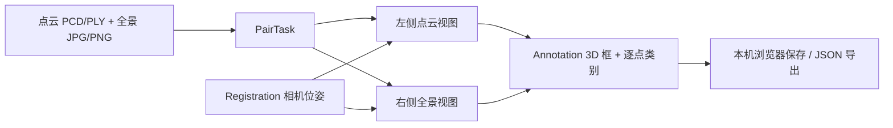

# 工作台 UI 与前端架构说明

当前版本为 0.16.0，主流程延续 **数据 → 配准 → 标注 → 训练**，项目设置独立放在底部。基础职责、布局原则和验收见 [0.13.0 工作流设计](WORKFLOW_UI_0.13.0.md)。

0.16.0 在配准页“粗配准”行加入 DA² / NID 方法选择，复用原有运行、取消、原位姿/候选预览、应用/舍弃入口。相对深度图放在可展开的结果区，避免常驻参数挤占视图。未通过检查的深度结果可以查看，位姿不能应用。没有增加导航项；模型部署、API 与交互状态见 [DA² 配准手册](DEPTH_REGISTRATION.md)。

## 产品范围与页面结构

SCRI Labeling（原 Atlas Studio）是用于点云/全景联合标注和普通图片复核的本地原型。默认进入数据管理；通过数据卡片或导入创建任务，再完成配准、标注和训练数据准备。

| 区域 | 当前作用 | 主要文件 |
| --- | --- | --- |
| 左侧主导航 | 数据、配准、标注、训练；底部项目设置 | `WorkflowShell.tsx` |
| 数据管理 | 统一任务选择、双源/图片导入；大文件处理说明 | `DataWorkspace.tsx` |
| 配准页 | 初值、同名点、投影核验；更多设置承接数值与算法参数 | `RegistrationWorkflow.tsx` |
| 标注页 | 类型切换、人工工具、AI 候选、多帧目标定位和核验 | `App.tsx` / `FrameNavigator.tsx` / `ImageReview.tsx` |
| 左视图 | Three.js 点云、可调点径、框、逐点类别、窗口放大 | `PointCloudView.tsx` |
| 右视图 | 球面全景、点/多边形；配准页支持投影核验 | `PanoramaView.tsx` |
| 对象面板 | 标注类别、对象列表、属性与跨视图关联；不含外参表单 | `App.tsx` |
| 训练页 | 核验统计、蒸馏训练清单与联合成果导出 | `TrainingWorkspace.tsx` |

深色侧栏只承载阶段导航，浅色主区突出当前任务。数据导入、模型选择、相机参数按需展开，避免用大量参数占据默认界面。主视觉由 `workflow.css` 定义，底层视图和对象面板沿用已有样式。标注页不提供同名点/外参修改；需要配准时进入主导航的配准页。

## 一个任务的状态流

`src/types.ts` 是共享数据类型。`PairTask` 定义一组配对文件；`Registration` 定义相机位置与 yaw/pitch/roll；`Annotation` 用同一个 `id` 关联点云 3D 框和全景点/多边形。逐点类别是独立的 `{pointIndex, classId}` 集合，适合墙面和地面等语义区域；它不自动形成对象 ID。右侧全景中的白色候选标记只是 3D 框中心的粗投影，不应当被视作已确认的双视图标注。

本机可选的尖沙咀真实样本依据 TREE 轨迹提供 **INS 粗配准**，没有独立标定的雷达到 Ladybug 杆臂及安装角。仓库默认的合成样本只用于演示交互，不代表真实传感器配准精度。配准页允许人工核验；任何 UI 文案都要保留这一精度界限。

## 标注交互约定

| 目标 | 操作 | 输出 |
| --- | --- | --- |
| 独立物体 / 构件 | 选类 → 3D 框模式 → 单击或拖拽框选 → 选中框 → 定位、移动、尺寸、旋转 | `Annotation.pointCloud` |
| 全景可见目标 | 保持同一对象被选中 → 全景点或多边形 | 同一 `Annotation.panorama` |
| 建筑表面 / 地面 | 选类 → 点云涂抹；Shift 框选，Alt/Option 擦除 | `semanticPointLabels` |
| 配准审核 | 开启投影核验 → 对照可辨认地物 → 调整位置和角度 | `Registration` |

标注结果只在用户点击“保存更改”时写入 `localStorage`；“导出结果”下载 JSON。浏览器直接导入的文件以临时 `blob:` URL 引用，刷新后要重新导入；正式多人协作须补资产服务、数据库、权限、审核状态和冲突处理。当前不具备这些后端能力。

## 模型接入边界

“项目设置 → 模型服务”页管理多个服务配置；图片复核页与点云／全景工作台各自只显示匹配的数据类型模型。运行前不上传文件。`src/modelRegistry.ts` 定义配置，`src/modelApi.ts` 和 `src/prelabel.ts` 定义协议与校验。预测结果显示为紫色待审核候选，`origin: "prediction"`，只有用户接受后才写入正式标注；逐点类别只填充尚未标注的点。切换任务或模型会丢弃未审核候选。详见[模型切换与审核](MODEL_SWITCHING.md)与[接口说明](MODEL_API.md)。

配置表单新增“适配方式”：标准 HTTP、千问视觉、DeepSeek 视觉。视觉 LLM 配置只记录模型名称，Key 与上游地址由本机启动环境提供；标注页仍沿用同一模型选择框和紫色候选审核。图片任务得到 2D 框；配对任务只在右侧全景生成 2D 区域，不在左侧点云伪造 3D 框。启动变量及接口见 [LLM 接入说明](LLM_PROVIDERS.md)。

训练页的“导出训练清单”在至少一张图片确认后可用，只导出人工确认图片的框与教师来源，供外部 2D 学生训练服务使用。它与包含全部任务的 YOLO 进度 ZIP 分开，避免未审核标签混入训练。训练配置、任务状态和评估展示待连接真实训练服务，不在当前标注流程中假装训练已完成；数据及 API 见 [蒸馏接口设计](DISTILLATION_API.md)。

## 给下一位开发者的起点

1. `npm ci`、`npm run dev` 可开发界面；使用视觉 LLM 代理时运行 `npm run build`、`npm run serve` 或双平台启动脚本，并按 [LLM 接入说明](LLM_PROVIDERS.md)设置环境变量。默认只监听 `127.0.0.1`，遇到端口占用自动改用空闲端口。
2. 先读 `src/types.ts`、`src/App.tsx`，再按修改区域查看两个视图组件及 `src/geometry.ts`、`src/boxFitting.ts`。
3. 修改数据契约时同步更新 [模型接口](MODEL_API.md)、[简化标注流程](labeling-workflow.md) 和导出版本；旧 `localStorage` 数据要有默认值。
4. `npm run build` 检查类型，`npm run package` 生成 Windows 和 macOS 两份同版本 ZIP；在 PR 中写明两侧视图、框编辑、涂抹及配准是否检查。

## 0.14.0 轮廓编辑

标注页工具下使用一行上下文操作栏，支持多边形/两点矩形、完成、撤销重做、增删顶点及重绘。`PanoramaEditor` 将归一化球面顶点投影为随相机移动的编号手柄，拖动不改变观察视角；`panoramaContours` 负责接缝、几何校验与多帧可见点交集；`annotationHistory` 保存页面内跨帧快照。`App` 协调当前帧轮廓与派生框失效。多帧观测新增可选 vertices，旧 bounds 仍兼容。详见 [轮廓操作与数据接口](PANORAMA_CONTOUR_EDITING.md)及 [逐项变化](CHANGELOG_0.14.0.md)。

0.14.1 新增逐帧 `observations[].extent`（object/surface，缺失按 surface），新人工对象默认圈完整物体。`triangulation.extent` 区分整体与单面候选；模式进入撤销历史、编辑保持、范围变更清除派生框，混用会拒绝定位。未改变模型推理或训练端点。界面流程及代码入口见 [墙体厚度说明](WALL_VOLUME_0.14.1.md)。
