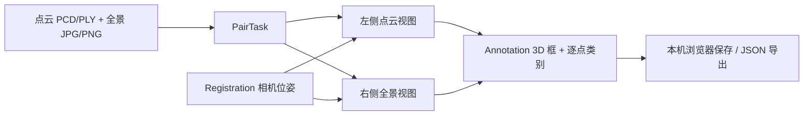

# 工作台 UI 与前端架构说明

## 产品范围与页面结构

Atlas Studio 是供点云与全景联合标注使用的本地前端原型。信息架构参考 Label Studio 的“任务 → 工作台 → 标注结果”流程，但核心工作台固定保留左右双视图。

| 区域 | 当前作用 | 主要文件 |
| --- | --- | --- |
| 左侧导航 | 工作台、任务列表、数据源、标签体系、配准校验、预标注接口 | `src/App.tsx` |
| 顶部任务栏 | 当前配对任务、对象数、保存、导出 | `src/App.tsx` |
| 工具栏 | 浏览、3D 框、点云涂抹、全景点/多边形、投影核验 | `src/App.tsx` |
| 左视图 | Three.js 点云、框选拟合、3D 手柄、逐点类别 | `src/PointCloudView.tsx` |
| 右视图 | 360° 全景、点/多边形、点云投影叠加 | `src/PanoramaView.tsx` |
| 右侧检查器 | 类别、对象列表、属性、配准参数 | `src/App.tsx` |

主布局由 `src/styles.css` 和 `src/responsive.css` 定义。导航深蓝、编辑区浅色、选中工具紫色、全景/配准状态青绿色。双视图各占工作区约一半；右侧检查器可收起。缩窄窗口后仍应能找到任务、类别、编辑工具和保存入口。不要把模型内部参数直接放进日常标注流程。

## 一个任务的状态流

`src/types.ts` 是共享数据类型。`PairTask` 定义一组配对文件；`Registration` 定义相机位置与 yaw/pitch/roll；`Annotation` 用同一个 `id` 关联点云 3D 框和全景点/多边形。逐点类别是独立的 `{pointIndex, classId}` 集合，适合墙面和地面等语义区域；它不自动形成对象 ID。右侧全景中的白色候选标记只是 3D 框中心的粗投影，不应当被视作已确认的双视图标注。

本机可选的尖沙咀真实样本依据 TREE 轨迹提供 **INS 粗配准**，没有独立标定的雷达到 Ladybug 杆臂及安装角。仓库默认的合成样本只用于演示交互，不代表真实传感器配准精度。配准页允许人工核验；任何 UI 文案都要保留这一精度界限。

## 标注交互约定

| 目标 | 操作 | 输出 |
| --- | --- | --- |
| 独立物体 / 构件 | 选类 → 3D 框模式 → 单击或拖拽框选 → 选中框 → 定位、移动、尺寸、旋转 | `Annotation.pointCloud` |
| 全景可见目标 | 保持同一对象被选中 → 全景点或多边形 | 同一 `Annotation.panorama` |
| 建筑表面 / 地面 | 选类 → 点云涂抹；Shift 框选，Alt/Option 擦除 | `semanticPointLabels` |
| 配准审核 | 开启投影核验 → 对照可辨认地物 → 调整位置和角度 | `Registration` |

标注结果只在用户点击“保存更改”时写入 `localStorage`；“导出结果”下载 JSON。浏览器直接导入的文件以临时 `blob:` URL 引用，刷新后要重新导入；正式多人协作须补资产服务、数据库、权限、审核状态和冲突处理。当前不具备这些后端能力。

## 模型接入边界

“预标注接口”页当前只收集服务地址，不调用模型。`src/prelabel.ts` 和 [接口说明](MODEL_API.md) 定义未来的上传与预测边界。预测结果应先显示为待审核候选，`origin: "prediction"`，只有用户接受后才写入正式标注。不要用预测直接覆盖手工框、手工逐点标签或配准修改。

## 给下一位开发者的起点

1. `npm ci`、`npm run dev`，使用终端显示的本地地址；默认只监听 `127.0.0.1`，遇到端口占用自动改用空闲端口。
2. 先读 `src/types.ts`、`src/App.tsx`，再按修改区域查看两个视图组件及 `src/geometry.ts`、`src/boxFitting.ts`。
3. 修改数据契约时同步更新 [模型接口](MODEL_API.md)、[简化标注流程](labeling-workflow.md) 和导出版本；旧 `localStorage` 数据要有默认值。
4. `npm run build` 检查类型，`npm run package` 生成 Windows 和 macOS 两份同版本 ZIP；在 PR 中写明两侧视图、框编辑、涂抹及配准是否检查。
