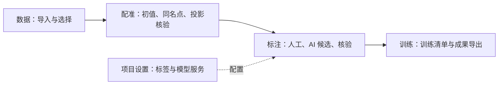

# 0.13.0 · 按工作流程重排 Demo

本版回应“导航重复、标注页混入配准操作、点大小调节无效、导入容量不清楚”。设计以任务顺序和功能归属为依据，采用四个主入口与一个设置入口；不宣称经过用户研究证明的最优设计。

## 信息架构与职责



| 主入口 | 包含 | 界面边界 |
| --- | --- | --- |
| 数据 | 双源任务卡片、浏览器导入、本机大点云导入说明、普通图片/YOLO 导入、进度 ZIP 恢复 | 合并旧“任务列表”和“数据源”；默认先显示数据，导入表单按需展开 |
| 配准 | 初值导入、自动服务候选、同名点、投影核验、逐帧观察 | 保留三步配准；参数和自动配准服务在“更多设置” |
| 标注 | 点云+全景/普通图片两种任务视图、框/涂抹/全景工具、AI 候选审核、多帧目标定位、结果导出 | 移除外参表单、同名点和配准步骤；只保留标注所需切帧、视角同步和对象面板 |
| 训练 | 人工确认统计、蒸馏清单导出、联合标注导出、训练连接状态 | 只导出已确认的 2D 样本，不虚构训练过程或精度结果 |
| 项目设置 | 标签体系与模型服务两个子页 | 替代独立“标签体系”“预标注接口”导航和侧栏 AI 配置卡 |

旧“道路设施复核”归入“标注 → 普通图片”，而非一个独立顶级模块。数据页的点云/图片分类、标注页的数据类型切换是任务类型选择，不是重复模块。页面内的下一步按钮负责沿流程推进；主导航始终只有四项。

## 点大小、缩放与窗口大小

旧自适应算法在用户点大小生效后才把点径限制到 1–10 像素，大量近处点停在上限，因此连续点“＋”看不出变化。现在先限制自动计算的基准点径，再乘用户倍率，达到上限的近处点也能继续改变。

- **自适应点径**：依据采样间距、距离和 FOV 给出基准，再应用手动倍率；有合法显示间距提示的场景可选。
- **固定像素**：直接按设定像素绘制，无需间距提示，适合检查密集立面和细节。
- **点大小滑杆、＋/−**：调整范围 0.6–8.2；自适应显示相对默认倍率，固定模式显示像素。仅调整显示，不改变点数、坐标、外参和标注。
- **滚轮**：同步模式调整两侧 FOV；自由观察模式使用点云环绕相机。点大小不是空间缩放。
- **放大点云窗口**：点云标题栏右侧按钮现在实际切为全宽点云，再点击“还原双视图”返回；之前该按钮只显示操作提示。

硬件仍可能把亚像素点限制为最小可显示像素，不应把它解释为几何缺失。点径变化也不会创造采集不到的点。

## 双源导入与 150 MiB

现在从 **数据 → 导入数据 → 点云 + 全景** 导入。浏览器方式选择一份 PCD/PLY、多张 2:1 全景和可选逐帧位姿/硬件外参 JSON，完成后进入配准。大于 150 MiB 的文件会明确提示并禁用浏览器创建，提供“查看本机大点云导入”。150 MiB 是文件容量，约 157 MB，不是空间距离。

**该数值是一次性浏览器直读的保护阈值，不是原始数据的项目级上限。** 原始大点云使用交付目录中的独立启动器处理：

```text
Windows: Import-Scene-Windows.bat "DATASET_FOLDER"
macOS:   sh ./Import-Scene-macOS.command "DATASET_FOLDER"
```

当前本机自动导入支持 `DenseMap.pcd` + `CameraPoseInSlam.csv` + 同目录全景，依赖项目目录内的独立 Python 环境；原始文件只读，受本机内存和处理时间限制。通过全图空间采样生成显示点云，保持地图范围。默认约 180 万显示点，可通过 `--point-budget 4500000` 或 `8000000` 提高细节，输出仍需符合浏览器上限。具体目录、坐标配置和缺位姿门控见 [跨场景导入合同](SCENE_IMPORT_VALIDATION.md)。

本轮没有直接把浏览器阈值提高到数 GB，也没有实现八叉树/分块流式加载。显示点索引与原始文件点索引不等同；若训练流程需要原始全分辨率逐点标签，需继续实现原始索引映射与分块资产接口。

## 图片会话与训练

`ImageReview` 将数据集、图片引用、核验状态和当前图片交给 App 级会话持有；在数据、标注、训练之间切换不会重新选择目录或跳回第一张。核验标签仍沿用原有 localStorage 保存与 YOLO ZIP 导出。浏览器手选文件在页面刷新后仍需重新选择，当前不提供后端资产数据库。

蒸馏导出统一到“训练”，继续使用既有 `buildDistillationManifest`，仅包含已核验样本及来源，保留已核验空图。当前页显式显示“训练服务未连接”；现有训练接口合同和客户端保留，本轮没有自动调用外部训练服务。千问、DeepSeek、HTTP 服务及其候选接受/拒绝流程保持原合同。

## 实现入口与验证

| 文件 | 分工 |
| --- | --- |
| `WorkflowShell.tsx` / `workflow.css` | 四步主导航、设置分组、全局布局、页面层级与响应布局 |
| `DataWorkspace.tsx` | 数据卡片、统一导入表单、超限提示和双平台本机导入说明 |
| `FrameNavigator.tsx` | 标注专属切帧、同步、多帧定位；没有配准参数和求解工具 |
| `RegistrationWorkflow.tsx` | 仅在配准路由挂载；原配准算法接口保持 |
| `ImageReview.tsx` / `App.tsx` | 图片导入与标注视图、跨页面会话、标注键盘事件限定当前工作台 |
| `TrainingWorkspace.tsx` | 已核验数据统计、已有合同导出、训练能力边界 |
| `PointCloudView.tsx` | GPU 点径计算顺序、固定模式、滑杆及显示诊断 |

Windows 本机浏览器已验证：四项导航；实际导入图书馆点云、七张原始全景和位姿；配准三步骤及不足四对同名点时的求解门控；进入标注后没有配准步骤/同名点工具；切帧两侧实际相机位置、四元数和 FOV 一致；151 MiB 测试文件触发超限提示；图片 900 张读取、切换到训练再返回保留当前图片且未改动标签；点云全宽放大与还原；“＋/−”改变设定；项目模型和标签设置可访问。

实际 GPU 截图对照记录固定像素与自适应两种模式的 0.6/8.2 设置，场景/相机保持一致，点云区域亮像素覆盖均明显变化；不是只检查滑杆值。完整截图与 JSON 指标留在本机 `release/`，未上传原始采集数据。另运行 `test:workflow` 检查导航分组、功能分离与训练门控，沿用其余模型、蒸馏、配准、场景和同步回归。

常规平台包与四场景私有试用包均提供 Windows/macOS。实体 Mac 图形性能仍待验收，4° 实际配准误差也未因 UI 重排而被证明。
